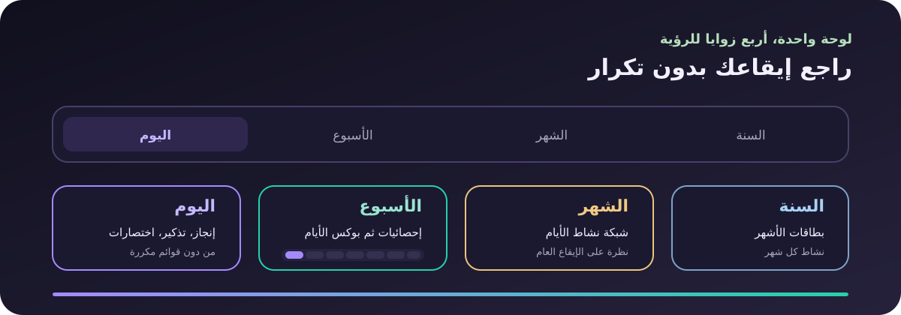

<p align="center">
  
</p>

<h1 align="center" dir="rtl">مِحوَر</h1>
<p align="center" dir="rtl"><strong>خطّط بلطف، وأنجز ما يهمك.</strong><br>لوحة عربية هادئة تجمع يومك، فتراتك، ومؤشرات تقدمك في مكان واحد.</p>
<p align="center"><a href="https://prog-alone.github.io/Mihwer/">افتح التطبيق</a></p>

<p align="center">
  
</p>

## كيف تعمل لوحة مِحوَر؟

تبدأ لوحة اليوم بملخص بصري واحد: نسبة الإنجاز، المهام، العادات، التركيز، واليوميات. لا تُعرض القوائم التفصيلية داخل اليوم حتى تبقى الصفحة خفيفة؛ تفتح التفاصيل الكاملة من تبويباتها المستقلة.

<p align="center">
  
</p>

- **اليوم:** إحصائيات مختصرة، تذكير اليوم، واختصارات سريعة للتدوين والتركيز والأهداف والتقدم.
- **الأسبوع:** بطاقة إنجاز وإحصائيات الأسبوع، ثم بوكس مدموج لسبعة أيام لاختيار يوم محدد.
- **الشهر:** ملخص الفترة ثم شبكة نشاط الأيام.
- **السنة:** ملخص السنة ثم بطاقات الأشهر ونسبة نشاط كل شهر.

## ابدأ في ثلاث خطوات

<p align="center">
  
</p>

اكتب عنوان المهمة واختر بطاقة الأولوية؛ ستظهر في الطابور، ويمكنك التبديل إلى عرض الأولويات. الموعد والتركيز والتفاصيل الإضافية اختيارية، وتبقى بياناتك محفوظة محلياً.

## الأقسام

<p align="center">
  
</p>

- **لوحة اليوم:** ملخص سريع بلا تكرار، مع روابط مباشرة للأقسام التي تحتاجها.
- **المهام:** طابور واضح، أولويات، مهام فرعية، ومواعيد.
- **العادات:** متابعة السلاسل والإنجاز اليومي دون ازدحام لوحة اليوم.
- **التركيز واليوميات:** سجّل جلسات التركيز أو فكرة اليوم من الاختصارات.
- **الأهداف والتقدم:** اربط ما تنجزه باتجاهك العام، ثم راجع الأرقام والتقارير والتصدير.

## بياناتك

تُحفظ البيانات محلياً في المتصفح. أنشئ نسخة احتياطية من الإعدادات قبل تغيير الجهاز؛ ويمكنك تفعيل المزامنة اختيارياً عبر GitHub Gist خاص. لا تحتاج اللوحة إلى خادم خلفي.

## التشغيل محلياً

لا تحتاج إلى تثبيت حزم:

```bash
python3 -m http.server 8000
```

ثم افتح [localhost:8000](http://localhost:8000). يتطلب العمل دون اتصال خادماً محلياً أو HTTPS.
