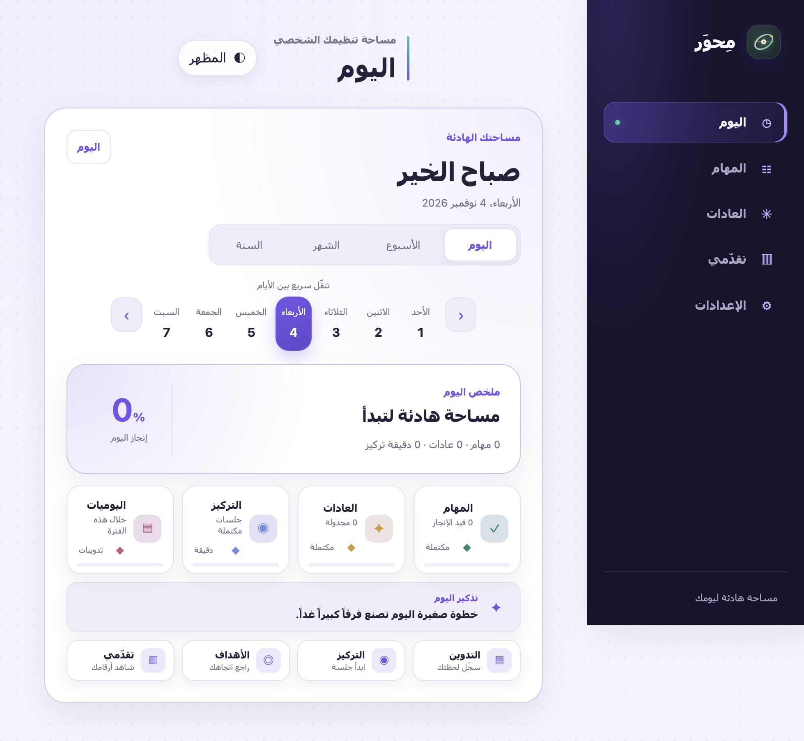
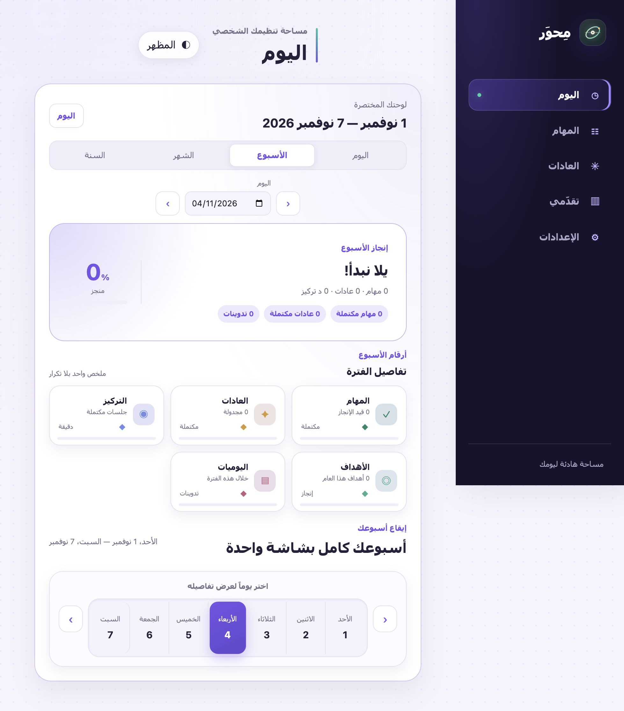
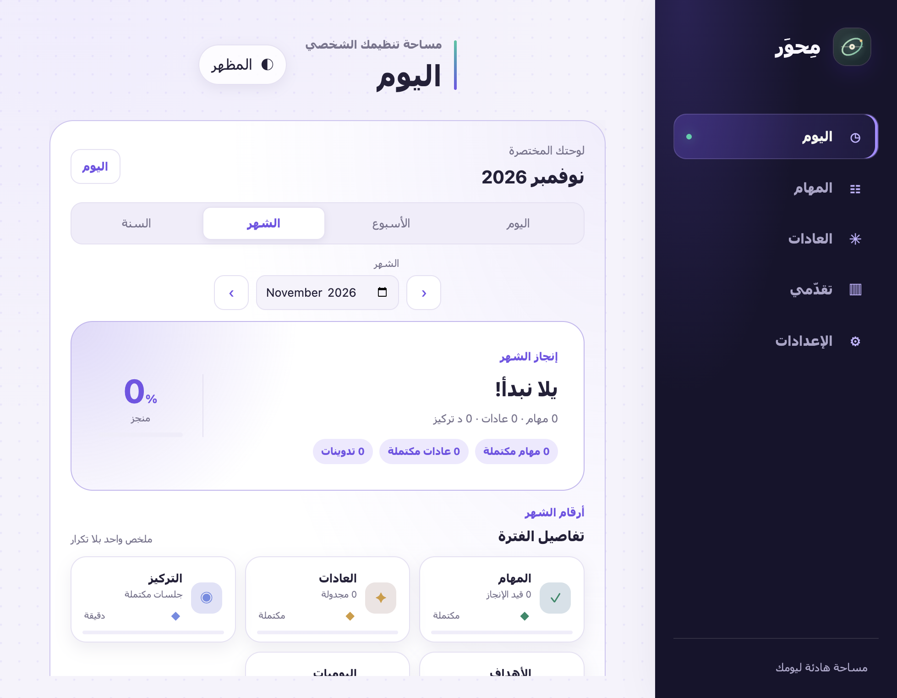
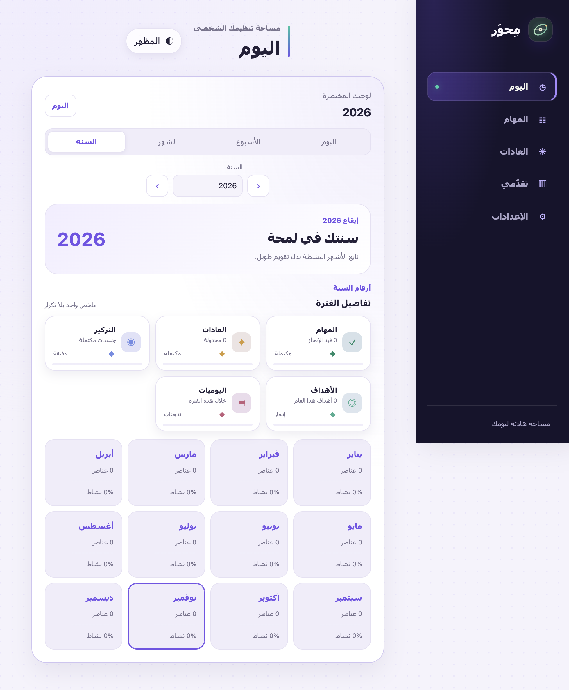

<div dir="rtl" align="center">

[](https://prog-alone.github.io/Mihwer/)

[**افتح التطبيق**](https://prog-alone.github.io/Mihwer/) · [**دليل الاستخدام داخل التطبيق**](https://prog-alone.github.io/Mihwer/#/help)

**مِحوَر** مساحة عربية هادئة تجمع المهام والعادات والتركيز واليوميات والتقدم في مكان واحد.

**الحالة: تجريبي.** الواجهة والميزات قيد التحسين المستمر.

</div>

## التجربة في أربع لقطات

### اليوم

ملخص سريع لما يهمك الآن: نسبة الإنجاز، الإحصائيات، والاختصارات اليومية.

[](./assets/readme/today-real.png)

### الأسبوع

بطاقة إنجاز واحدة وبوكس مدموج للأيام السبعة، دون تكرار أو ازدحام.

[](./assets/readme/week-real.png)

### الشهر

شبكة نشاط واضحة تساعدك على رؤية إيقاع الشهر.

[](./assets/readme/month-real.png)

### السنة

ملخص خفيف للأشهر ونسبة النشاط خلال السنة.

[](./assets/readme/year-real.png)

## كيف تستخدم مِحوَر؟

1. أضف المهمة وحدد الأولوية.
2. تابع يومك من لوحة اليوم أو الأسبوع.
3. سجّل العادات والتركيز واليوميات عند الحاجة.
4. راجع أرقامك وتقاريرك وصدّر بياناتك.

## الأقسام

- **المهام:** طابور واضح، أولويات، مهام فرعية، ومواعيد.
- **العادات:** متابعة السلاسل والإنجاز اليومي.
- **التركيز:** جلسات تركيز واستراحات قابلة للتخصيص.
- **اليوميات:** تدوين سريع مرتبط بيومك.
- **الأهداف والتقدم:** مراجعة الاتجاه العام والأرقام والتصدير.

## بياناتك

التقدم محفوظ محليًا على جهازك، ولا تحتاج اللوحة إلى خادم خلفي.
يظهر تذكير كل جمعة لأخذ نسخة احتياطية. يمكنك اختيار مكان الحفظ عندما يدعم المتصفح ذلك، وتُسمّى كل نسخة باسم اليوم والتاريخ.
المزامنة عبر GitHub Gist اختيارية.

## التشغيل محليًا

لا تحتاج إلى تثبيت حزم:

```bash
python3 -m http.server 8000
```

ثم افتح [localhost:8000](http://localhost:8000).

* * *

تصميم وتطوير **PROG-ALONE** · [مِحوَر](https://github.com/PROG-ALONE/Mihwer)
