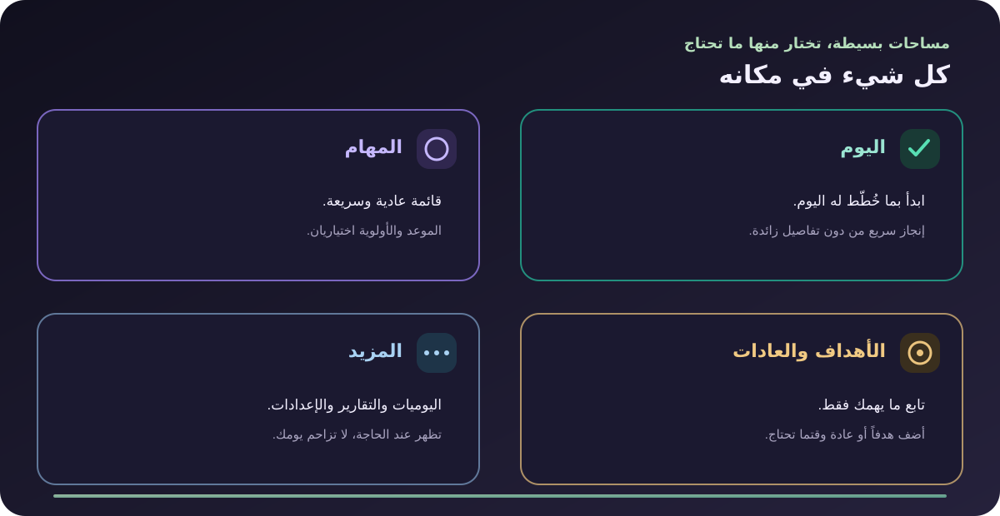

<p align="center">
  
</p>

<h1 align="center" dir="rtl">مِحوَر</h1>
<p align="center" dir="rtl"><strong>خطّط بلطف، وأنجز ما يهمك.</strong><br>تطبيق عربي بسيط للمهام اليومية والأهداف والعادات.</p>
<p align="center"><a href="https://prog-alone.github.io/Mihwer/">افتح التطبيق</a></p>

<p align="center">
  
</p>

## ابدأ في ثلاث خطوات

<p align="center">
  
</p>

اكتب عنوان المهمة واختر بطاقة الأولوية؛ ستظهر في الطابور، ويمكنك التبديل إلى عرض الأولويات. الموعد والتركيز والتفاصيل الإضافية اختيارية.

## الأقسام

<p align="center">
  
</p>

- **لوحة اليوم:** تظهر في تبويب اليوم فقط، وتلخّص المهام والعادات والأهداف والتركيز. تنقّل بين أي يوم أو شهر أو سنة لفتح تفاصيل الفترة.
- **الأقسام:** افتح تبويب المهام أو الأهداف أو العادات أو التركيز لإدارة تفاصيله كاملة.
- **الأهداف والعادات:** متابعة اختيارية لما تريد تطويره.
- **المزيد:** اليوميات، التقارير، الإعدادات، ودليل الاستخدام.

## بياناتك

تُحفظ البيانات محلياً في المتصفح. أنشئ نسخة احتياطية من الإعدادات؛ ويمكنك تفعيل المزامنة اختيارياً عبر GitHub Gist خاص.

## التشغيل محلياً

لا تحتاج إلى تثبيت حزم:

```bash
python3 -m http.server 8000
```

ثم افتح [localhost:8000](http://localhost:8000). يتطلب العمل دون اتصال خادماً محلياً أو HTTPS.
